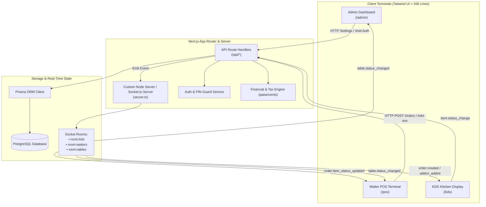
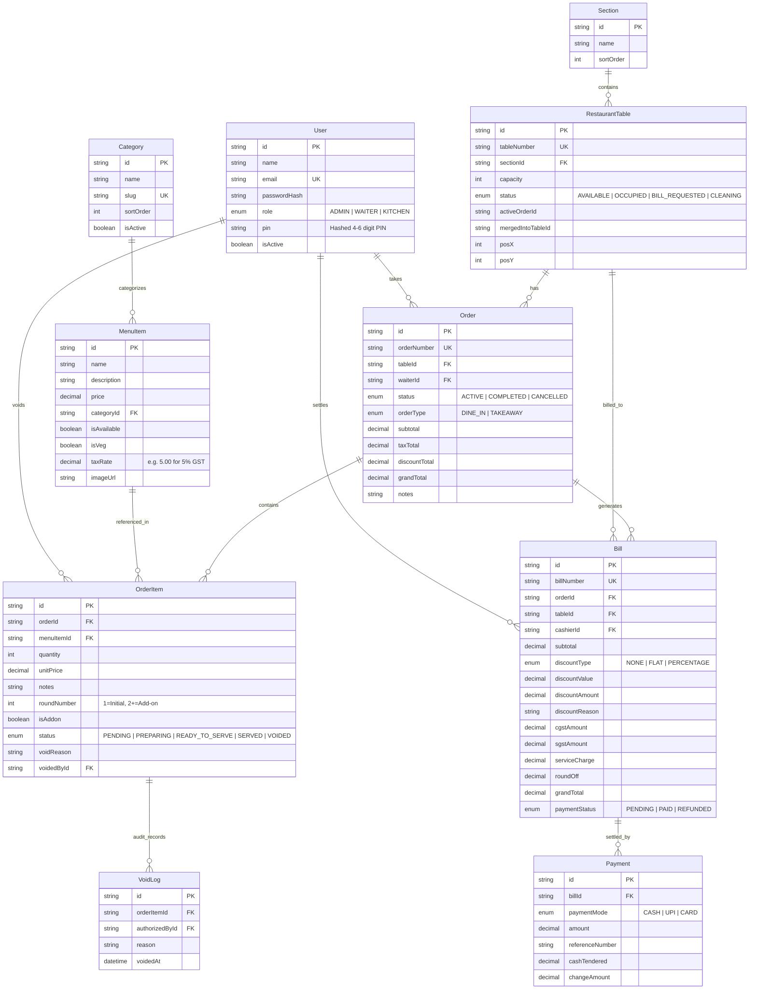
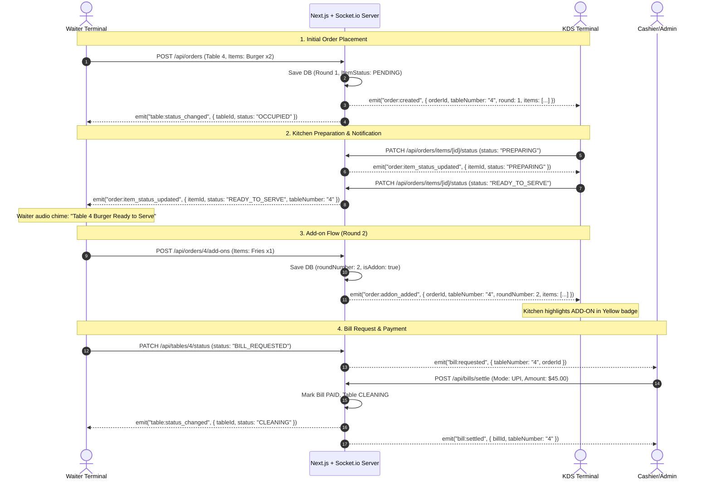

# Implementation Plan: Hotel & Restaurant Management System (POS & KDS)

## Goal Description
Build a full-stack, enterprise-grade, touch-optimized Hotel & Restaurant Management System featuring:
- Role-based interfaces: **Admin Dashboard**, **Front-of-House Waiter POS**, and **Real-Time Kitchen Display System (KDS)**.
- High-contrast, dark-mode first modular UI (strictly under 200 lines per component).
- Real-time bi-directional synchronization via **Socket.io** for instant order routing, add-on alerts, item status transitions, and table state updates.
- Robust financial computations on the server with exact decimal handling for taxes (GST/VAT), multi-tender split payments, and audit-logged Admin PIN void workflows.

---

## Architecture Overview



---

## User Review Required

> [!IMPORTANT]
> **Currency & Decimal Storage:** All prices and monetary calculations are modeled using standard integer currency subunits (e.g., paise for INR or cents for USD) and Prisma `Decimal(10, 2)` to guarantee zero floating-point rounding errors across split checks and taxes.

> [!WARNING]
> **Next.js & Socket.io Server Architecture:** Because standard Next.js serverless route handlers cannot maintain persistent WebSocket connections, we propose a custom server setup (`server.ts` using `tsx` or custom `node` server with `socket.io` wrapping Next.js) or a standalone lightweight WebSocket sidecar. The custom server (`server.ts`) is standard for production Next.js + Socket.io apps.

---

## 1. Database Schema (`prisma/schema.prisma`)



### Full Proposed Prisma Schema
```prisma
datasource db {
  provider = "postgresql"
  url      = env("DATABASE_URL")
}

generator client {
  provider = "prisma-client-js"
}

enum Role {
  ADMIN
  WAITER
  KITCHEN
}

enum TableStatus {
  AVAILABLE
  OCCUPIED
  BILL_REQUESTED
  CLEANING
}

enum OrderStatus {
  ACTIVE
  COMPLETED
  CANCELLED
}

enum OrderType {
  DINE_IN
  TAKEAWAY
}

enum ItemStatus {
  PENDING
  PREPARING
  READY_TO_SERVE
  SERVED
  VOIDED
}

enum DiscountType {
  NONE
  FLAT
  PERCENTAGE
}

enum PaymentStatus {
  PENDING
  PAID
  REFUNDED
}

enum PaymentMode {
  CASH
  UPI
  CARD
}

model User {
  id           String     @id @default(cuid())
  name         String
  email        String     @unique
  passwordHash String
  role         Role       @default(WAITER)
  pin          String?    // Hashed PIN for Admin void / waiter quick sign-in
  isActive     Boolean    @default(true)
  orders       Order[]    @relation("WaiterOrders")
  bills        Bill[]     @relation("CashierBills")
  voidedItems  OrderItem[] @relation("VoidAuthorizer")
  voidLogs     VoidLog[]  @relation("ManagerVoidLogs")
  createdAt    DateTime   @default(now())
  updatedAt    DateTime   @updatedAt
}

model Section {
  id          String            @id @default(cuid())
  name        String            @unique
  sortOrder   Int               @default(0)
  tables      RestaurantTable[]
  createdAt   DateTime          @default(now())
  updatedAt   DateTime          @updatedAt
}

model RestaurantTable {
  id                String            @id @default(cuid())
  tableNumber       String            @unique
  sectionId         String
  section           Section           @relation(fields: [sectionId], references: [id])
  capacity          Int               @default(4)
  status            TableStatus       @default(AVAILABLE)
  activeOrderId     String?           @unique
  mergedIntoTableId String?
  posX              Int               @default(0)
  posY              Int               @default(0)
  orders            Order[]
  bills             Bill[]
  createdAt         DateTime          @default(now())
  updatedAt         DateTime          @updatedAt
}

model Category {
  id          String     @id @default(cuid())
  name        String     @unique
  slug        String     @unique
  sortOrder   Int        @default(0)
  isActive    Boolean    @default(true)
  items       MenuItem[]
  createdAt   DateTime   @default(now())
  updatedAt   DateTime   @updatedAt
}

model MenuItem {
  id          String      @id @default(cuid())
  name        String
  description String?
  price       Decimal     @db.Decimal(10, 2)
  categoryId  String
  category    Category    @relation(fields: [categoryId], references: [id])
  isAvailable Boolean     @default(true)
  isVeg       Boolean     @default(true)
  taxRate     Decimal     @default(5.00) @db.Decimal(5, 2) // e.g., 5% GST
  imageUrl    String?
  orderItems  OrderItem[]
  createdAt   DateTime    @default(now())
  updatedAt   DateTime    @updatedAt
}

model Order {
  id            String        @id @default(cuid())
  orderNumber   String        @unique // e.g., ORD-20261114-001
  tableId       String?
  table         RestaurantTable? @relation(fields: [tableId], references: [id])
  waiterId      String
  waiter        User          @relation("WaiterOrders", fields: [waiterId], references: [id])
  status        OrderStatus   @default(ACTIVE)
  orderType     OrderType     @default(DINE_IN)
  subtotal      Decimal       @default(0.00) @db.Decimal(10, 2)
  taxTotal      Decimal       @default(0.00) @db.Decimal(10, 2)
  discountTotal Decimal       @default(0.00) @db.Decimal(10, 2)
  grandTotal    Decimal       @default(0.00) @db.Decimal(10, 2)
  notes         String?
  items         OrderItem[]
  bills         Bill[]
  createdAt     DateTime      @default(now())
  updatedAt     DateTime      @updatedAt
}

model OrderItem {
  id          String      @id @default(cuid())
  orderId     String
  order       Order       @relation(fields: [orderId], references: [id], onDelete: Cascade)
  menuItemId  String
  menuItem    MenuItem    @relation(fields: [menuItemId], references: [id])
  quantity    Int         @default(1)
  unitPrice   Decimal     @db.Decimal(10, 2)
  notes       String?
  roundNumber Int         @default(1) // 1 = initial order, 2+ = add-on
  isAddon     Boolean     @default(false)
  status      ItemStatus  @default(PENDING)
  voidReason  String?
  voidedById  String?
  voidedBy    User?       @relation("VoidAuthorizer", fields: [voidedById], references: [id])
  voidedAt    DateTime?
  voidLogs    VoidLog[]
  createdAt   DateTime    @default(now())
  updatedAt   DateTime    @updatedAt
}

model Bill {
  id             String        @id @default(cuid())
  billNumber     String        @unique // e.g., INV-20261114-0001
  orderId        String
  order          Order         @relation(fields: [orderId], references: [id])
  tableId        String?
  table          RestaurantTable? @relation(fields: [tableId], references: [id])
  cashierId      String
  cashier        User          @relation("CashierBills", fields: [cashierId], references: [id])
  subtotal       Decimal       @db.Decimal(10, 2)
  discountType   DiscountType  @default(NONE)
  discountValue  Decimal       @default(0.00) @db.Decimal(10, 2)
  discountAmount Decimal       @default(0.00) @db.Decimal(10, 2)
  discountReason String?
  cgstAmount     Decimal       @default(0.00) @db.Decimal(10, 2)
  sgstAmount     Decimal       @default(0.00) @db.Decimal(10, 2)
  serviceCharge  Decimal       @default(0.00) @db.Decimal(10, 2)
  roundOff       Decimal       @default(0.00) @db.Decimal(10, 2)
  grandTotal     Decimal       @db.Decimal(10, 2)
  paymentStatus  PaymentStatus @default(PENDING)
  payments       Payment[]
  createdAt      DateTime      @default(now())
  updatedAt      DateTime      @updatedAt
}

model Payment {
  id              String      @id @default(cuid())
  billId          String
  bill            Bill        @relation(fields: [billId], references: [id], onDelete: Cascade)
  paymentMode     PaymentMode
  amount          Decimal     @db.Decimal(10, 2)
  referenceNumber String?     // Transaction ref for UPI or Card
  cashTendered    Decimal?    @db.Decimal(10, 2)
  changeAmount    Decimal?    @db.Decimal(10, 2)
  createdAt       DateTime    @default(now())
}

model VoidLog {
  id             String    @id @default(cuid())
  orderItemId    String
  orderItem      OrderItem @relation(fields: [orderItemId], references: [id])
  authorizedById String
  authorizedBy   User      @relation("ManagerVoidLogs", fields: [authorizedById], references: [id])
  reason         String
  voidedAt       DateTime  @default(now())
}
```

---

## 2. API & Real-Time WebSocket Event Architecture

### 2.1. REST API Route Handlers

| Route | Method | Access Role | Description |
|---|---|---|---|
| `/api/auth/login` | POST | Public | Staff/Admin login with credentials or quick PIN |
| `/api/auth/verify-void-pin` | POST | Admin | Verifies Admin master Void PIN |
| `/api/tables` | GET, POST | All / Admin | Fetch table matrix with active order metadata / Create table |
| `/api/tables/[id]` | PATCH, DELETE | Admin | Update table details or delete table |
| `/api/tables/[id]/status` | PATCH | Waiter, Admin | Manual status update (`Available`, `Cleaning`, etc.) |
| `/api/tables/transfer` | POST | Waiter, Admin | Transfer active order from source to target table |
| `/api/tables/merge` | POST | Waiter, Admin | Merge multiple tables into one active session |
| `/api/menu/categories` | GET, POST | All / Admin | List or create categories |
| `/api/menu/items` | GET, POST | All / Admin | List menu items or create items |
| `/api/menu/items/[id]` | PATCH, DELETE | Admin | Edit price/details or toggle 86'd status |
| `/api/orders` | GET, POST | All / Waiter | Fetch active orders / Create new order (Round 1) |
| `/api/orders/[id]` | GET | All | Get order details with items, rounds, and subtotal |
| `/api/orders/[id]/add-ons` | POST | Waiter | Add incremental items (Round 2+) |
| `/api/orders/items/[itemId]/status`| PATCH | Kitchen, Waiter | Update item status (`PENDING` ➔ `PREPARING` ➔ `READY_TO_SERVE`) |
| `/api/orders/items/[itemId]/void` | POST | Waiter / Admin | Void item. If in `PREPARING` status, requires valid Void PIN |
| `/api/kds/tickets` | GET | Kitchen | Fetch all active KDS tickets sorted chronologically (FIFO) |
| `/api/kds/tickets/[id]/bump` | POST | Kitchen | Mark entire ticket or remaining items as ready / bump off screen |
| `/api/bills/preview` | POST | Waiter, Admin | Compute preview calculations (Subtotal, GST, discounts, roundoff) |
| `/api/bills/settle` | POST | Admin, Waiter | Settle bill (Cash/UPI/Card/Split) and set table to `CLEANING` |
| `/api/reports/sales` | GET | Admin | Daily sales, category summaries, payment splits, average kitchen prep times |

---

### 2.2. Real-Time Socket.io Event Specification



#### Event Catalog
- `table:status_changed`
  - Payload: `{ tableId: string, status: TableStatus, activeOrderId?: string, updatedBy: string }`
  - Target: All connected terminals (`room:restaurant`)
- `order:created`
  - Payload: `{ orderId: string, orderNumber: string, tableNumber: string, items: OrderItemDTO[], roundNumber: 1, createdAt: string }`
  - Target: `room:kds`
- `order:addon_added`
  - Payload: `{ orderId: string, tableNumber: string, items: OrderItemDTO[], roundNumber: number, isAddon: true }`
  - Target: `room:kds` (triggers distinct alert chime)
- `order:item_status_updated`
  - Payload: `{ orderId: string, itemId: string, tableNumber: string, status: ItemStatus, itemName: string }`
  - Target: `room:waiters`, `room:kds`
- `order:item_voided`
  - Payload: `{ orderId: string, itemId: string, tableNumber: string, reason: string, authorizedBy: string }`
  - Target: `room:kds`, `room:waiters`
- `bill:requested`
  - Payload: `{ tableId: string, tableNumber: string, orderId: string, subtotal: number }`
  - Target: `room:waiters`, `room:admin`
- `bill:settled`
  - Payload: `{ billId: string, tableId: string, tableNumber: string, grandTotal: number, paymentMode: string }`
  - Target: `room:restaurant`

---

## 3. Modular Project Directory Structure

Adheres strictly to the **< 200 lines per component** rule and Next.js App Router conventions:

```text
d:/Antigravity/
├── prisma/
│   ├── schema.prisma                  # Proposed Prisma schema
│   └── seed.ts                        # Seed initial sections, tables, menu, admin
├── src/
│   ├── app/                           # Next.js App Router
│   │   ├── (admin)/admin/
│   │   │   ├── layout.tsx             # Admin sidebar & header shell (< 150 lines)
│   │   │   ├── page.tsx               # Analytics & dashboard overview
│   │   │   ├── tables/page.tsx        # Dynamic Table & Section configuration
│   │   │   ├── menu/page.tsx          # Menu, categories, and 86'd management
│   │   │   ├── staff/page.tsx         # Staff accounts & PIN management
│   │   │   └── reports/page.tsx       # Sales & kitchen turnaround reports
│   │   ├── (pos)/pos/
│   │   │   ├── layout.tsx             # POS header with waiter status & alerts
│   │   │   ├── page.tsx               # Interactive Table Grid screen
│   │   │   └── order/[tableId]/page.tsx # Order Entry & Add-on terminal
│   │   ├── (kds)/kds/
│   │   │   ├── layout.tsx             # Full-screen KDS header with active timers
│   │   │   └── page.tsx               # Real-time FIFO order ticket grid
│   │   ├── api/                       # REST endpoints
│   │   │   ├── auth/
│   │   │   ├── tables/
│   │   │   ├── menu/
│   │   │   ├── orders/
│   │   │   ├── kds/
│   │   │   ├── bills/
│   │   │   └── reports/
│   │   ├── layout.tsx                 # Root layout with TanStack Query Provider
│   │   └── page.tsx                   # Role selection / Terminal landing
│   ├── components/                    # Modular UI (< 200 lines per component)
│   │   ├── ui/                        # Reusable primitives (Button, Modal, Badge, Input, Card)
│   │   ├── pos/
│   │   │   ├── TableCard.tsx          # Single table card with status badge (< 120 lines)
│   │   │   ├── TableGrid.tsx          # Section-filtered table matrix (< 150 lines)
│   │   │   ├── CategoryNav.tsx        # Horizontal swipeable category list (< 90 lines)
│   │   │   ├── MenuItemCard.tsx       # Touch-friendly menu item tile (< 120 lines)
│   │   │   ├── MenuSearch.tsx         # Search bar with quick filters (< 80 lines)
│   │   │   ├── OrderCartDrawer.tsx    # Slide-over order summary (< 180 lines)
│   │   │   ├── OrderItemRow.tsx       # Single cart row with notes & quantity (< 110 lines)
│   │   │   ├── TableTransferModal.tsx # Transfer order to another table (< 140 lines)
│   │   │   ├── TableMergeModal.tsx    # Merge tables selector (< 150 lines)
│   │   │   ├── VoidAuthModal.tsx      # Admin PIN keypad modal for voids (< 130 lines)
│   │   │   └── BillPreviewModal.tsx   # Bill breakdown & split calculator (< 190 lines)
│   │   ├── kds/
│   │   │   ├── KDSTicketCard.tsx      # Chronological order ticket (< 170 lines)
│   │   │   ├── KDSTicketHeader.tsx    # Table #, timer, and order status (< 90 lines)
│   │   │   ├── KDSItemRow.tsx         # Item row with tap-to-progress status (< 110 lines)
│   │   │   └── KDSAddonBadge.tsx      # Visual pulse badge for add-on rounds (< 50 lines)
│   │   ├── admin/
│   │   │   ├── TableEditorModal.tsx   # Table positioning & capacity form (< 160 lines)
│   │   │   ├── MenuItemFormModal.tsx  # Create/edit menu item dialog (< 180 lines)
│   │   │   └── AnalyticsChart.tsx     # Sales & turnaround time chart (< 160 lines)
│   │   └── shared/
│   │       ├── AudioAlerts.tsx        # Sound synthesizer for kitchen/ready chimes (< 80 lines)
│   │       └── ReceiptPrintView.tsx   # 80mm printable thermal receipt layout (< 150 lines)
│   ├── hooks/
│   │   ├── useSocket.ts               # Socket.io connection & subscription hook
│   │   ├── useOrderCart.ts            # Local cart state manager with Zustand
│   │   ├── useTableTimer.ts           # Elapsed timer calculation hook
│   │   └── useKDSQueue.ts             # KDS ticket queue sorting & sound trigger
│   ├── lib/
│   │   ├── db.ts                      # Prisma client singleton
│   │   ├── calculations.ts            # Pure functions for GST, discount, and splits
│   │   ├── pin.ts                     # Salt & hash verification for Void PIN
│   │   └── socket.ts                  # Client socket instance
│   ├── server/
│   │   ├── socketServer.ts            # Socket.io server handlers & room router
│   │   └── events.ts                  # Typed socket event constants
│   ├── types/
│   │   ├── index.ts                   # Domain models and API DTOs
│   │   └── socket.ts                  # Typed Socket.io client-server event contracts
│   └── server.ts                      # Custom Next.js + Socket.io Node server entry point
├── package.json
├── tsconfig.json
├── tailwind.config.ts
├── SPEC.md
└── AGENTS.md
```

---

## 4. Verification Plan

### Automated Verification
1. **Type & Lint Checking:**
   ```bash
   pnpm run lint
   npx tsc --noEmit
   ```
2. **Database Migration & Generation:**
   ```bash
   npx prisma validate
   npx prisma generate
   ```
3. **Unit Tests (Vitest):**
   ```bash
   pnpm test
   ```
   - Test `calculations.ts`: Validate exact rounding, multi-tier GST (2.5% CGST + 2.5% SGST), flat and percentage discounts, and equal/itemized bill splits.
   - Test `pin.ts`: Verify Admin PIN hashing and rejection of unauthorized void requests.

### Manual Verification
1. **Multi-Role Browser Verification:**
   - Open 3 browser windows side-by-side:
     - Window 1: **Waiter POS** (`/pos`)
     - Window 2: **KDS Kitchen Display** (`/kds`)
     - Window 3: **Admin Dashboard** (`/admin`)
2. **Workflow Validation:**
   - Waiter opens Table 4, adds 2 items, places order.
   - Verify Table 4 shifts from `Available` to `Occupied` instantly on Waiter and Admin screens.
   - Verify KDS displays Ticket #1 in `Pending` status with elapsed timer running.
   - Kitchen marks item as `Preparing`, then `Ready to Serve`. Verify sound/visual alert reaches Waiter terminal.
   - Waiter adds Round 2 add-on item. Verify KDS highlights ticket with an amber **[ADD-ON]** badge.
   - Attempt to void an item in `Preparing` state without Admin PIN -> Verify error. Enter Admin PIN -> Verify void succeeds and is logged in `VoidLog`.
   - Waiter requests bill -> Admin/Cashier settles via UPI -> Verify table status automatically resets to `Cleaning`.
